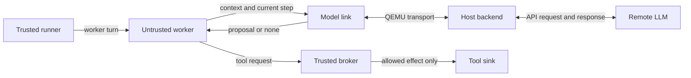

# Microkit runtime: high-level extension plan

5 November 2026. Original discussion plan. The user subsequently authorised the detailed host-backend implementation. Stage 1 is now implemented; [setup and status](HOST_BACKEND.md) and the [validation record](evidence/validation-2026-11-05.md) supersede its open design choices. Offline checks and the real API control pass, but oversized malicious proposals prevent a fully passing live campaign. Later stages remain suggestions.

## Aim and fixed boundary

Investigate whether the runtime enforces its stated policy while useful tasks complete. Keep the plan static and trusted: the runner owns workflow execution, the untrusted worker proposes actions, and the broker controls tool effects. The LLM does not become the planner.

The existing open/fenced email runs remain regression cases. Extend the implementation under `research/`, preserving the original discovery repository and SDK.

## Starting architecture

Start with the ordinary Python API client, for example the `openai` package with the Responses API. An agent SDK is optional later if a bounded workflow stage needs richer orchestration. Host code forwards proposals; it does not execute their tool effects directly.

Use one backend interface with three modes:

- **Scripted:** reproduce the existing worker behaviour through the new link.
- **Adversarial:** deliberately submit hostile, malformed, duplicate or stale proposals.
- **LLM:** obtain proposals from a remote model using dummy context.

The first interface should accept at most one tool proposal per turn, or none. Specify size limits, request/session identifiers, timeouts, response validation and whether tool decisions are fed back. Retain identical model-facing tool definitions across open/fenced runs so the broker remains the enforcement mechanism being tested.

## Proposed progression

| Stage | Smallest useful extension | Evidence sought |
|---|---|---|
| 1. Host backend | Carry context and proposals over a model link; first scripted, then remote inference | Scripted traces still match the reference; LLM proposals pass through the same broker; record outcomes and failures |
| 2. Exact-call approval | Approve one destination and payload once; attempt an injected send before the authorised send | Mismatching call blocked without consuming the approval; authorised effect occurs exactly once; duplicates rejected |
| 3. Useful fixed workflow | Read documents, summarise, draft a reply, obtain trusted approval and send | Legitimate completion under benign and attacked inputs; account for malicious model-generated values as well as extra calls |
| 4. Named sources and contracts | Introduce two sources and destinations, then check argument/destination rules | Correct source classification and policy/effect agreement; redirects and outbound reads cannot evade mediation |
| 5. Session lifecycle | Re-grant authority in a second round, comparing stale and fresh state | Reject old-epoch requests; test retained context, derived summaries, queues and backend conversation state |

Stages after the host backend are suggestions, not selected implementation commitments. Named sources, logging and protocol work may be needed earlier once the workload is chosen.

For the smallest file-input experiment, repurposing QEMU's second UART for the model link is a candidate. Supporting live attacker traffic simultaneously requires a separate link or a carefully specified multiplexed protocol. Transport and protection-domain wiring remain design choices.

## Evidence throughout

Add request identifiers and correlate model proposals, broker decisions and independently recorded sink effects. Develop a trusted release-build log channel; the current shared debug console is analyst evidence and can be written by untrusted domains.

Measure legitimate completion, completion under attack, unauthorised effects, bypass attempts, crashes, timeouts, duplicate effects, latency and approval burden. Preserve versions, prompts, model settings, run counts and raw results. An LLM declining an attack is a behavioural observation; direct adversarial proposals remain necessary to test enforcement.

Map each extension to the paper's deployment obligations. Where applicable, use its separation and plan checkers on the encoded configuration; acceptance does not by itself establish correspondence with the C implementation.

## Claim limits and open decisions

- A host backend and remote model are outside seL4 confinement. Dummy data is acceptable for this experiment; broker-mediated guest effects do not establish containment of a malicious host process.
- The paper's one-call model restricts obedience scheduling. A real model may depend on secrets or denials; fixed workflow execution alone does not establish those assumptions.
- A generated summary used by the plan introduces answer-corruption and poisoned-value questions. It must not be treated as trusted merely because the plan uses it.
- Clearing the visible context and advancing an epoch do not prove freshness. A session reset must address everything model-visible derived from untrusted content, including summaries and backend state.
- Finite trace agreement and unsuccessful attacks are empirical evidence, not a runtime-refinement proof. A worker that leaks before the current fence remains a known policy limitation.

The subsequent implementation uses a versioned hex protocol over UART1, file emails,
`gpt-6-luna`, a six-attempt campaign ledger and explicit failure handling. Broader
networking, a Linux VM and inference inside a Microkit domain remain later options.

## Sources and continuity

- [Current experiment and debugging checklist](README.md); discovery baseline `explorations@f0a4c4e97150f3a335f53b5ceb4c6cf410399ecc`.
- [Relative Security instantiation boundary](../../../prompt-injection-RS/INSTANTIATION.md), inspected at `4c0d9e5d59b90a42dea4cf8a235474b83fbf792e`: deployment obligations, source/destination policies, sessions and fixed-plan scope. Proofs were not rebuilt.
- [Airlock overlap assessment](../../notes/airlock-overlap.md) and [backlog](../../../airlock/ISSUES.md): related proposals, especially exact approval, sessions, model transport and trusted logging; not evidence of implemented features.
- Official OpenAI documentation: [function calling](https://developers.openai.com/api/docs/guides/function-calling) and [Agents SDK](https://developers.openai.com/api/docs/guides/agents/sdk), consulted 5 November 2026 for the API/client/orchestration distinction.
