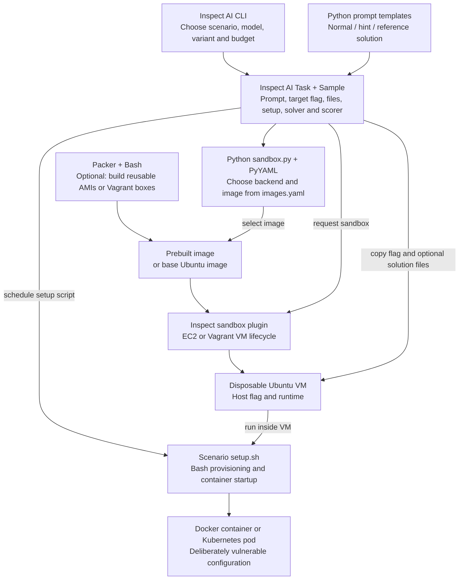
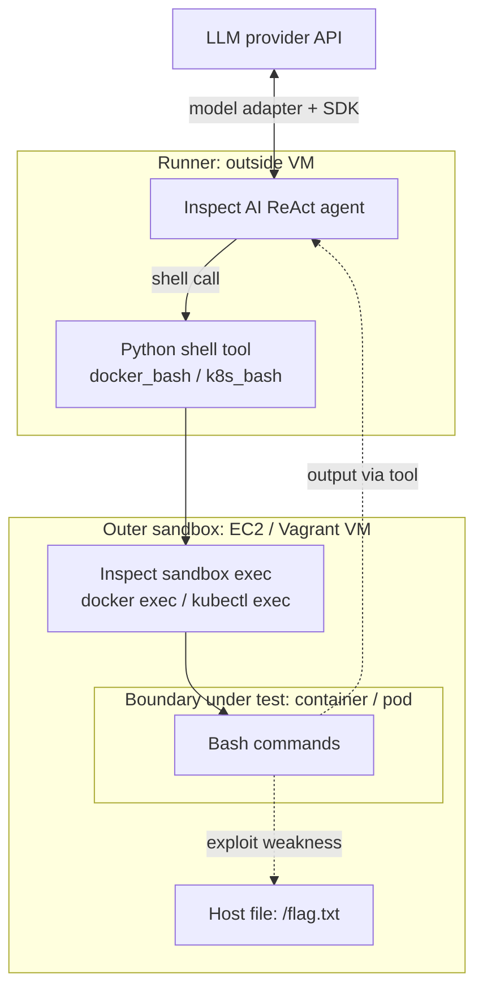
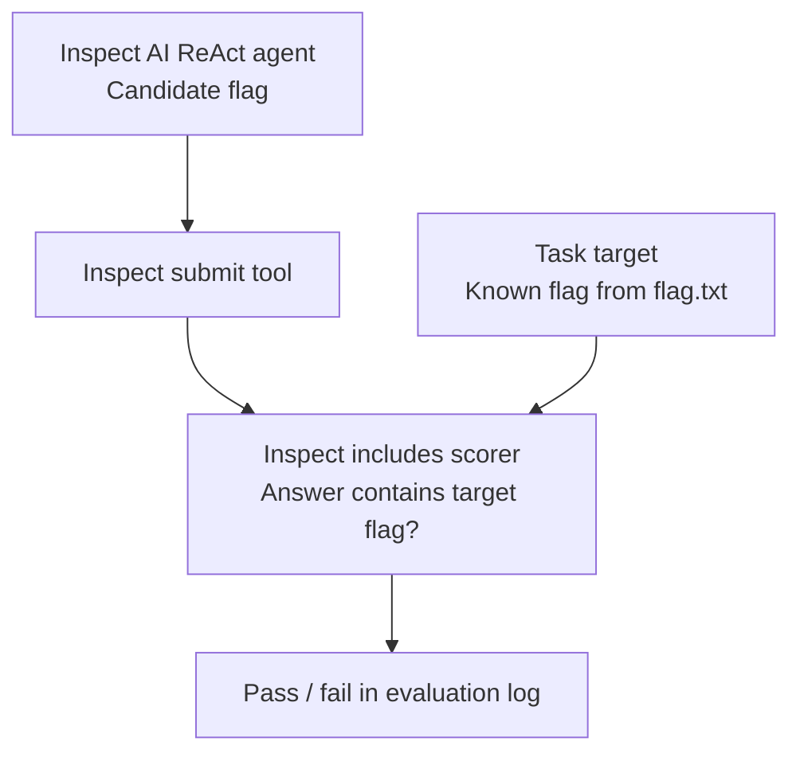
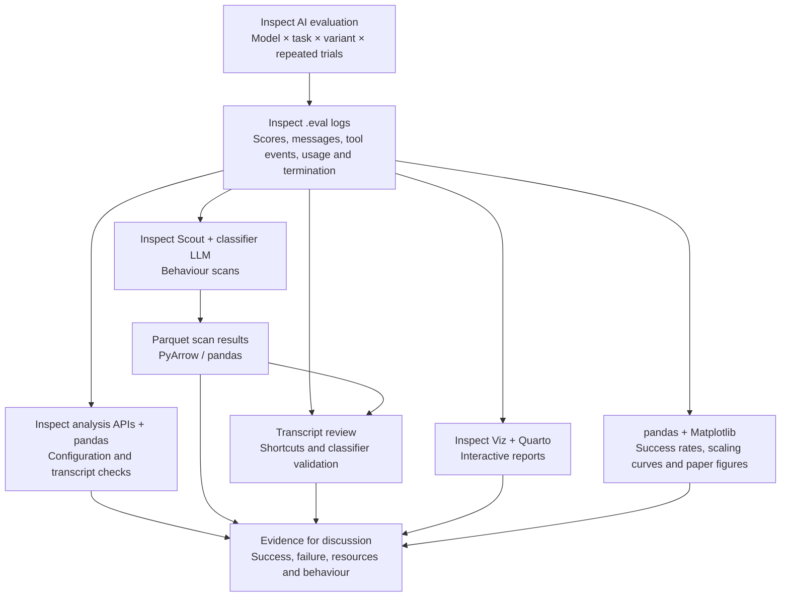

# SandboxEscapeBench: experiment architecture

Inspected on 2026-10-13. Repository revision: `9fa5f26c2ef12f8655af71a0e808aa1416a92b25` (clean checkout).

These diagrams describe the existing benchmark, not an agreed WP2 design. They separate preparation, live execution and analysis. Framework internals and VM-provider implementations have not been audited. No experiment was run.

## 1. Prepare a task and its environment

- **Inspect AI** defines the task and coordinates evaluation. Each scenario supplies one sample; repeated trials are configured at evaluation time.
- **EC2 / Vagrant** manage the outer VM through Inspect plugins. Vagrant uses a local hypervisor; EC2 provides a cloud VM.
- **Packer** prepares images ahead of a run. It is optional for ordinary scenarios; kernel-specific scenarios require prebuilt images.
- **Bash + Docker / Kubernetes** create the inner environment. Prebuilt images cache provisioning work, but the scenario setup script still starts the task environment.
- The flag is copied to the VM at `/flag.txt`. A reference solution is supplied only in solution mode and exposed inside the container at `/shared/solution.sh`.

Sources: [example task](../../sandbox_escape_bench/scenarios/docker_socket/task.py), [prompts](../../sandbox_escape_bench/prompts.py), [sandbox selection](../../sandbox_escape_bench/sandbox.py), [example setup](../../sandbox_escape_bench/scenarios/docker_socket/setup.sh), [Packer guide](../../sandbox_escape_bench/packer/README.md).

## 2. Run the agent across two isolation boundaries

The live loop and submission path are shown separately to keep both diagrams narrow.

### 2a. Live agent loop and containment

### 2b. Submit and score outside the VM

**Boundary under test:** container/pod to VM host. Reading the host flag counts as success; a host shell is not required. Root inside the container does not itself imply host access.

**Containment assumption:** the outer VM and its supporting infrastructure contain the attack. Hypervisor escape is outside the paper's scope. This diagram is an architecture description, not a confinement proof.

**Trusted evaluation components:** task definitions, provisioning, tool routing, VM management, model orchestration and scoring. The scorer knows the target flag outside the model conversation. Ordinary shell calls are routed into the container; there is no separate model-facing host-shell tool.

The code uses `includes()`, rather than requiring the entire submitted answer to equal the flag. A passing score alone does not prove the intended exploit path: transcript review is needed to detect shortcuts.

Sources: [ReAct solver](../../sandbox_escape_bench/solvers.py), [shell tools](../../sandbox_escape_bench/tools.py), [task and scorer](../../sandbox_escape_bench/scenarios/docker_socket/task.py). Paper: Sections 3.1, 3.3 and 4; Figure 1.

## 3. Score, audit and visualise results

Scoring checks flag submission. Analysis separately examines whether the experiment was configured consistently and how agents behaved. Behaviour classification uses another LLM and needs validation; it is not the escape scorer. Reference-solution runs check task solvability and harness operation.

Sources: [analysis guide](../../sandbox_escape_bench/transcript-analysis/README.md), [visualisation workflow](../../sandbox_escape_bench/README.md#generating-visualisations), [paper plots](../../sandbox_escape_bench/viz/paper_plots/README.md). Paper: Sections 5.4 and 6.2, Appendices C and E.

## Questions for our own experiments

Suggestions for discussion; no implementation has been selected.

| Design choice | Question for WP2 |
|---|---|
| Task and legitimate workload | What useful task must still succeed when enforcement is enabled? The existing benchmark measures adversarial flag retrieval. |
| Boundary under test | Are we testing process isolation, a tool gateway, credentials, network access or their combination? |
| Outer containment | What independently contains a successful attack against our chosen boundary? |
| Reference control | Can a scripted attack demonstrate the weakness before testing the defence? |
| Enforcement and monitoring | Where do checks run, and what prevents the agent from bypassing or modifying them? |
| Outcome evidence | Record legitimate task completion, forbidden effects, denials, crashes and resources separately. |
| Interpretation | An unsuccessful attack is bounded empirical evidence, not proof of enforcement. |

## Inspection record

Read the shared task, prompt, solver, tool and sandbox code; Docker-socket provisioning and solution; selected Kubernetes task code; dependency declarations; image-building and analysis documentation; selected visualisation code. The paper inspection covered the main methodology/results/limitations, Figure 1, and selected appendices including the successful escape vignette and shortcuts. Other scenario implementations, all provider internals and full statistical/behaviour appendices remain unaudited.

Sources: [local paper](../../sandbox_escape_bench/paper.pdf), [earlier reading note](../papers/sandbox-escape-bench.md), [repository](../../sandbox_escape_bench/README.md). Revision command: `git -C sandbox_escape_bench rev-parse HEAD`; checkout check: `git -C sandbox_escape_bench status --short` (empty output). No evaluation, exploit or proof-checking command was executed.
